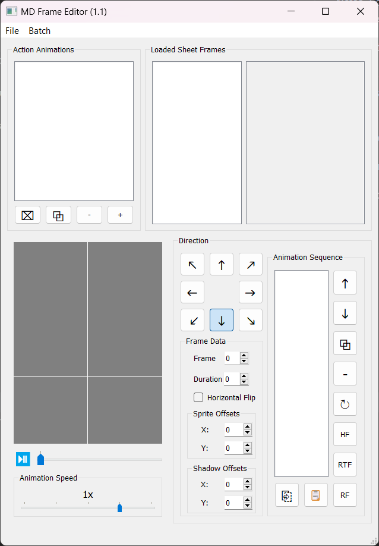

Frame editor to edit FrameData.xml/AnimData.xml sheets and see results live instead of manually editing XML data and importing into your game.

**Note:**
For an easier time, use existing FrameData or AnimData to use and modify. Also make sure the FrameWidth, FrameHeight XML datas are accurate for the sheet you are using.

### Controls
* **Open / Ctrl+O** - Select one or several sprite XML files. Each sprite opens
  in its own tab, named after its containing folder.
* **Save / Save As / Export** - Apply to the active sprite tab. Each tab keeps
  its edits, selection, zoom, and shadow preview independently.
* **O** - Toggle Offset Display (Action Points), if loaded.
* **S** - Toggle Shadow Display.
* **Mouse Scroll** - Zoom in and Out of Preview. Zooming in follows the sprite's offsets as it animates.
* **Hold Ctrl + Mouse Scroll** - Adjust opacity of loaded sprite.

### Save Options

**Trim Copies**: Instead of writing full animation data, will instead write an Animation Action as CopyOf data. If your program doesn't handle this scenario, leave unchecked to write all frame data.

**Collapse Singles**: If there is only one sequence that is the same for all 8 directions, it will save it as 1 sequence. If your program doesn't handle this scenario, leave unchecked to write all 8 sequences.

### Running from source

Use Python 3.9 or newer. From the project directory, activate your virtual
environment and install the project and its dependencies:

```shell
python -m pip install -e ".[gui]"
python main.py
```

Dependencies are declared in `pyproject.toml`.

### Building

If you want to build yourself, you can do so via Pyinstaller: `pyinstaller MDFrameEditor.spec` or Nuitka.

Download for a Windows and MacOS version are provided. Untested on Linux, although it should build and work there.

----
1.4.3:
* Change: From PyQt5 to PySide6.
* Fix: ActionPoints factory issue on newer Pythons.
* Fix: Change arrow keys to be unicode versions, otherwise they show as invalid characters in MacOS.
* Fix: Update Batch Add Layout.
* Add: Specfile support for MacOS.

1.4.2:
* Fix: Shadow saving as brown instead of black.
* Change: Now checks for multi-sheet export eligibility before outputting frames.
* Add: Frame information when failing to export multi-sheets due to unmatching frames.
* Add: Warning if frames are evenly divisible when loading a single sheet.

1.4.1:
* Fix: Shadow positions when previewing and exporting.
* Fix: Shadows being flipped when exporting.

1.4:
* Add: Offsets (Action Point) preview markers. Use O to toggle on or off. (Only works if offsets were loaded.)
* Add: Toggle Shadows option.
* Change: Pausing an animation will now set the frame data of the frame it paused on.
* Change: Ignore extra empty frames if action points were loaded.
* Fix: Shadow positions being off by 1 when importing multi and exporting single.

1.3:
* Add: You can now load multi-sheet images and data.
* Add: You can now export new multi-sheets and single sheets.
* Fix: Crash when changing frame index numbers.
* Fix: Blank AnimSequences referring to the same set of data.

1.2:
* Fix: Collapsable accidentally combining if there was just 1 other direction that matched.

1.1: 
* Fix: The original of a copy is no longer set as a copy preventing copy loop.
* Fix: No longer writes -1 as the index ID if it does not exist. It is omitted now.
* Fix: Animation speed label no longer squashed on some display settings.
* Change: Trim/Collapse save options are now default.
* Add: Error message if OpenGL version is not supported.
* Add: Image to readme.
 
1.0:
* Initial Release

### Known Issues
* **False virus notification**: Due to PyInstaller (the packaging utility) being used by people to package malicious 
 programs, many anti-virus programs may flag this packaged program. To get around this you will have to add an exception with your antivirus to the directory you will keep the program at.
 [Click here for an article on adding exceptions for Microsoft Defender](https://support.microsoft.com/en-us/windows/add-an-exclusion-to-windows-security-811816c0-4dfd-af4a-47e4-c301afe13b26)

If you don't trust the release versions, you can download the source and package it into an executable yourself with pyinstaller:
`pyinstaller MDFrameEditor.spec`




### Command-line conversion

Convert an XML file and its accompanying PNGs without opening the editor:

```shell
python main.py convert sprites/FrameData.xml --to multi --output converted/multi
python main.py convert sprites/AnimData.xml --to single --output converted/single
```

Convert a folder tree with four parallel workers:

```shell
python main.py convert sprites --to single --output converted --recursive --jobs 4
```

Folder conversion finds `AnimData.xml` for `--to single`, or `FrameData.xml` for
`--to multi`, and preserves each sprite's relative folder under the output folder.
Without `--recursive`, only the input folder itself is searched. An output folder
inside the input tree is excluded from the search. An explicit XML input may have
a different filename; its format is detected from its contents. Keep its PNGs
beside the source XML.

Conversions default to multiprocessing with up to four workers. Use `--jobs` to
change the worker count, or `--executor serial` to run without a worker pool.
Conversions use the same Pillow/XML backend and transactional export as the
editor, without importing Qt, pyglet, or GUI modules or changing application preferences.
Sources are kept intact; choose a separate output folder. Destinations containing
files require `--overwrite`; child sprite directories do not block parent exports.
A failed sprite is reported while other sprites
continue. Exit codes are 0 for success, 1 for conversion failures, and 2 for invalid
arguments or input selection.

Use `--no-trim-copies` to expand copy references, and `--no-collapse-singles` to
write all eight directions. Both compact representations are enabled by default.
For help, run `python main.py convert --help`.

Installing the project also provides the equivalent console command:

```shell
mdframeedit-convert sprites --to multi --output converted --recursive --jobs 4
```

For CLI-only use, `python -m pip install -e .` installs just Pillow. Qt and pyglet
are optional dependencies, installed with the `gui` extra shown above.
